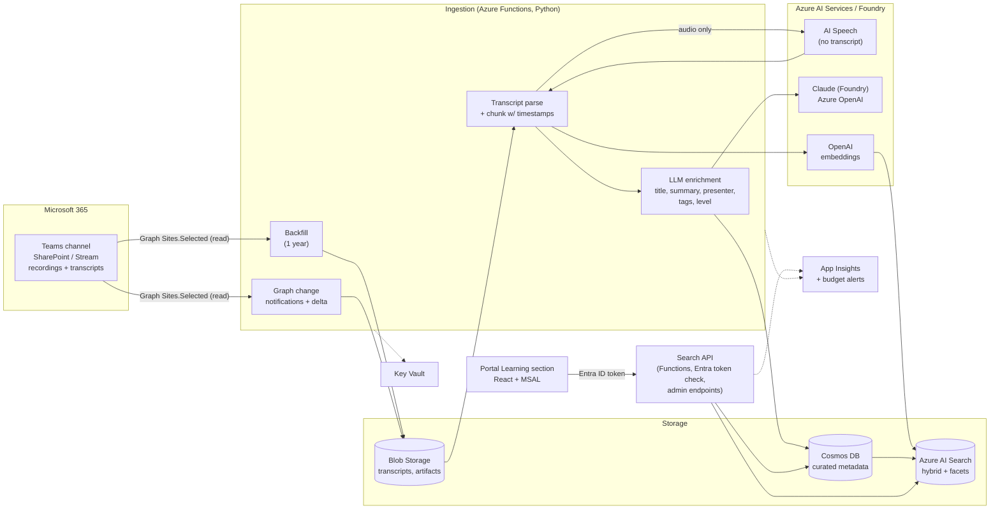

# Architecture

Rendered: [architecture.svg](architecture.svg) / [architecture.png](architecture.png) (source: [architecture.mmd](architecture.mmd), regenerate with `npx @mermaid-js/mermaid-cli -i docs/architecture.mmd -o docs/architecture.svg`).

## Components and week mapping

| Component | Bicep module | Built in week |
|---|---|---|
| Entra ID app regs (backend API, SPA), Graph `Sites.Selected` | manual - see [environments.md](environments.md) | 1-2 |
| Key Vault, App Insights, Log Analytics, budget | `keyvault`, `monitoring`, `budget` | 1 |
| Function App (Flex Consumption, managed identity) | `functionapp`, `rbac` | 1 (health only) |
| Graph ingestion: backfill + change notifications/delta | - | 2 |
| Blob Storage for transcripts/artifacts | `storage` | 1 (infra), 2 (code) |
| Azure AI Speech for recordings without transcript | `ai` | 2-3 |
| Transcript parse/chunk, LLM enrichment, embeddings | `ai` | 3 |
| Cosmos DB curated metadata, AI Search index | `cosmos`, `search` | 3 |
| Search API + admin endpoints | `functionapp` (Easy Auth) | 4 |
| React Learning section (MSAL) | - (portal) | 4 |

## Key decisions (week 1)

- **Adapters first.** `RecordingSource` protocol (`backend/minicode/inventory/sources.py`) with `MockRecordingSource` now and `GraphRecordingSource` later; the rest of the pipeline is source-agnostic. App setting `MINICODE_SOURCE=mock|graph`.
- **One Function App** for ingestion and API to start with; split if scaling or deployment cadence differ.
- **Cosmos DB serverless** over Azure SQL: document-shaped metadata, tiny volume, pay-per-request. Revisit if the portal team prefers SQL.
- **Identity-only access**: shared keys disabled on Storage, Cosmos, AI Services; the Function App uses its managed identity with data-plane RBAC.
- **Visibility**: all minicodes are visible to all employees, so the API only checks for a valid signed-in token (no per-meeting ACL).
