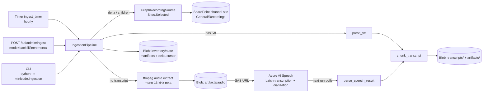
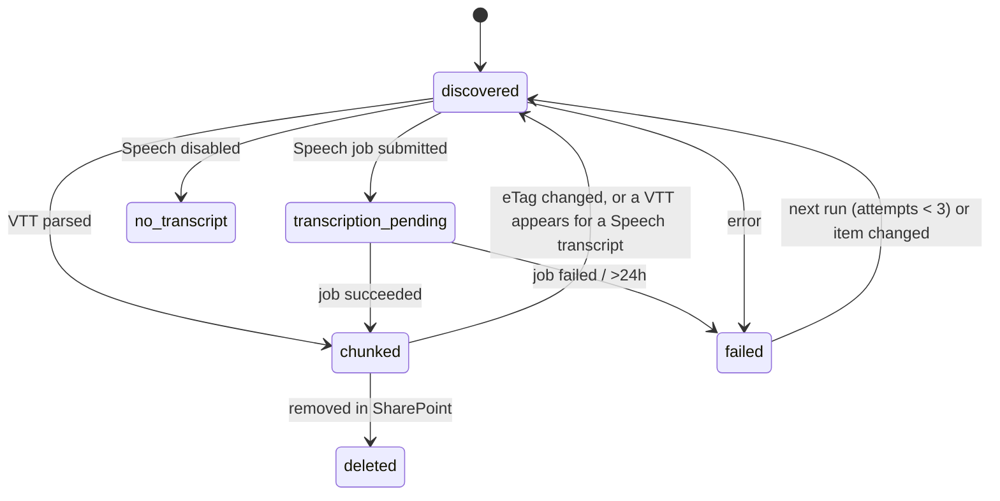

# Week 2 – Ingestion & transcripts

Status: **code complete against mocks**. The real Microsoft Graph and Azure AI Speech clients are implemented and run in tests against an in-process fake cloud (`httpx.MockTransport`). Switching to real services is configuration only (see [Switching to real Graph / Speech](#switching-to-real-graph--speech)).

## Flow



1. **Discover**: `GraphRecordingSource` lists the video files in the channel's Recordings folder recursively (`/drives/{id}/root:/{folder}:/children`, nextLink paging). The `title`, `organizer` (`createdBy.user`), `createdDateTime`, `eTag`, size and MIME type are mapped to `Recording`. A same-stem `.vtt` next to the video counts as an attached transcript.
2. **Window**: anything older than `BACKFILL_LOOKBACK_DAYS` (365) is skipped as `out_of_window`. Non-video files (`.pptx` etc.) are never returned.
3. **Transcript**:
   - If a `.vtt` exists, it is downloaded, parsed (`<v Speaker>` tags, multi-line cues, `NOTE` blocks, `hh:mm:ss.mmm`/`mm:ss.mmm`) and stored.
   - Otherwise the audio is extracted with ffmpeg, uploaded to blob and submitted as a Speech **batch transcription** (fi-FI with en-US language identification, diarization). Functions never block on Speech: the job URL is saved in the manifest and the **next run** polls it. The CLI can `--wait`.
4. **Chunk**: cues are merged into chunks of at most ~400 tokens / 180 s with 15 s overlap. Very long cues are split. Every chunk keeps `start`/`end` (seconds), `speakers`, and its text prefixed with `Name:` on speaker change. Ids are `{recordingId}-{nnnn}`, ready for the week 3 search index.
5. **State**: one manifest per recording and a delta cursor make runs **idempotent and resumable** (see below).

Incremental runs call Graph **delta**. Because Graph delta works only on the drive root, results are filtered by `parentReference.path`. Deletions are always reported, and a late `.vtt` triggers re-processing of its video. If the delta token has expired (`410 resyncRequired`) or there is no cursor yet, the run falls back to a full backfill.

## Blob layout

| Container | Path | Content |
|---|---|---|
| `transcripts` | `raw/{id}.vtt` / `raw/{id}.speech.json` | original Teams VTT / Speech result |
| `transcripts` | `parsed/{id}.json` | normalized cues `{start,end,speaker,text}` + source, language, speakers, duration |
| `artifacts` | `recordings/{id}.json` | metadata: title, normalized title (naming convention), organizer, dates, Graph ids, transcript source |
| `artifacts` | `chunks/{id}.json` | chunks for embedding / indexing |
| `artifacts` | `audio/{id}.m4a` | temporary Speech input, deleted after the job finishes |
| `inventory` | `state/recordings/{id}.json` | manifest (stage, etag, attempts, error, Speech job URL) |
| `inventory` | `state/delta.json` | Graph delta link |
| `inventory` | `runs/{timestamp}.json` | run summary (outcomes, errors, per-item results) |

`{id}` is the Graph drive item id.

## State machine and idempotency



- A recording that is `chunked` with an unchanged eTag is `unchanged` and no work is done. `--force` / `force=true` reprocesses everything.
- Failures are isolated per recording, recorded in the manifest and the run summary, and retried up to 3 times. A new eTag resets the counter.
- The delta cursor is captured **before** listing and saved only after the run, so a crashed run is simply repeated. Recordings that already completed are skipped (tested by killing a run mid-way).
- Graph 429/5xx responses are retried, honouring `Retry-After`.

## Run locally

```powershell
cd backend
..\.venv\Scripts\python -m minicode.ingestion backfill --wait     # mock cloud -> ..\out\blob
..\.venv\Scripts\python -m minicode.ingestion backfill --wait     # again: everything "unchanged"
..\.venv\Scripts\python -m minicode.ingestion incremental         # delta run
..\.venv\Scripts\python -m minicode.ingestion status              # stages per recording
..\.venv\Scripts\python -m minicode.ingestion backfill --speech off --out ..\out\nospeech -v
```

The mock cloud is built from `backend/minicode/samples/recordings.json`. It contains 10 items relative to "now":
- 7 minicode videos within the last year:
  - 4 have Teams-style VTT transcripts with `<v Speaker>` tags (one in Finnish);
  - 3 have no transcript, so they go through the Speech path with diarized fi-FI/en-US results.
- 1 `.pptx` ("PowerPoint Presentation").
- 2 recordings older than a year.

Functions host (needs Azure Functions Core Tools + Azurite for the timer trigger):

```powershell
cd backend
copy local.settings.sample.json local.settings.json
func start
curl -X POST "http://localhost:7071/api/admin/ingest?mode=backfill"
```

## Settings

| Setting | Default | Meaning |
|---|---|---|
| `MINICODE_SOURCE` | `mock` | `mock` (fake cloud) or `graph` |
| `MINICODE_SITE_ID` | – | SharePoint site id `host,siteGuid,webGuid` (required for `graph`) |
| `MINICODE_DRIVE_ID` | site default drive | document library drive id |
| `MINICODE_FOLDER_PATH` | `General/Recordings` | channel folder relative to the drive root |
| `MINICODE_STORAGE` | `local` (`azure` in Bicep) | `local` filesystem or `azure` Blob Storage |
| `MINICODE_LOCAL_STORE` | `<repo>/out/blob` | root for local storage |
| `STORAGE_BLOB_ENDPOINT` | – | `https://<account>.blob.core.windows.net` |
| `MINICODE_SPEECH` | `auto` | `auto` (on if `AI_SERVICES_ENDPOINT` set), `azure`, `off` |
| `AI_SERVICES_ENDPOINT` | – | AI Services / Speech endpoint (custom subdomain) |
| `SPEECH_LOCALE` / `SPEECH_CANDIDATE_LOCALES` | `fi-FI` / `fi-FI,en-US` | Speech locale + language identification candidates |
| `BACKFILL_LOOKBACK_DAYS` | `365` | ingestion window |
| `BACKFILL_SCHEDULE` | `0 0 * * * *` | timer CRON (hourly) |
| `INGESTION_ENABLED` | `true` | kill switch for the timer |

All of these are set by `infra/main.bicep`.

## Switching to real Graph / Speech

1. **Sites.Selected** (see [week1-checklist.md](week1-checklist.md)):
   - Grant the Function App's managed identity, or the `minicode-ingest-<env>` app, the Graph **application** permission `Sites.Selected`.
   - Then add a per-site `read` grant: `POST /sites/{siteId}/permissions` with `roles: ["read"]`.
   - Auth uses `azure-identity` `DefaultAzureCredential` (managed identity in Azure; `az login` / env vars locally) with the scope `https://graph.microsoft.com/.default`.
2. **Find the ids** (as an admin, Graph Explorer):
   - `GET /sites/{tenant}.sharepoint.com:/sites/{site}` returns the `id`, which goes into `minicodeSiteId`.
   - `GET /sites/{id}/drives` returns the drive id; it is optional if the recordings are in the default "Documents" library.
   - Check the channel folder name; recordings are usually under `<Channel name>/Recordings`. Set `minicodeFolderPath`.
3. **Speech**: Bicep already grants the Function MI *Cognitive Services Speech User* on the AI Services account. Speech must read the audio, so `MINICODE_STORAGE=azure` is required: the pipeline hands Speech a short-lived user-delegation SAS. Local storage only produces `file://` URLs.
4. **ffmpeg**: `imageio-ffmpeg` ships a static ffmpeg binary in the deployment package (≈30 MB). On the Function host, `find_ffmpeg()` uses `PATH` first, then that binary.
5. Set `MINICODE_SOURCE=graph` (Bicep does this when `minicodeSiteId` is non-empty) and run `POST /api/admin/ingest?mode=backfill` once. The hourly timer then keeps the content in sync.

## Tests

| File | Covers |
|---|---|
| `test_transcripts.py` | WebVTT parser (speaker tags, multi-line, notes, BOM, errors), Speech result parser, VTT round-trip |
| `test_chunking.py` | token/time bounds, overlap, speaker prefixes, long-cue splitting, ids |
| `test_graph.py` | Graph client against the fake cloud: paging, recursion, sidecar VTT, 429 retry, delta (new/changed/deleted/late VTT/out-of-folder), 410 |
| `test_speech.py` | batch request shape, submit/poll/result/delete, failed jobs, real ffmpeg extraction (skipped without ffmpeg) |
| `test_storage.py` | local blob store, SAS/URL behaviour |
| `test_pipeline.py` | end-to-end backfill, idempotent rerun, force, async Speech completion, failures + attempt cap, timeouts, window, incremental, expired cursor, crash/resume |
| `test_function_app.py` | `/api/admin/ingest` handler against mocks |

## Open questions / to verify with real access

- **Where Teams transcripts live.** Teams usually stores the transcript inside the Stream/OneDrive media item, or behind the `onlineMeeting` transcripts API (`OnlineMeetingTranscript.Read.All`, meeting-organizer scoped), **not** as a `.vtt` file next to the video. The sidecar `.vtt` is an assumption that also covers manually uploaded transcripts. Once we have access, check one recording:
  - `GET /drives/{d}/items/{id}?$expand=listItem` and the media/transcript facets;
  - if needed, add a second transcript adapter.
  Until then, recordings without a sidecar VTT go to Speech, which costs more but works.
- **Speech API details.** Diarization (`diarization.enabled` + `maxSpeakers`) combined with language identification on `2024-11-15` is unverified. Check it with a real request; if the combination is rejected, fall back to a fixed `fi-FI` locale.
- **Long recordings in Functions.** Extracting audio from a 1–2 h, 1 GB video on Flex Consumption may approach timeouts or disk limits. Measure on a real file; alternatives are streaming the download URL straight into ffmpeg (already supported) or a Container Apps job.
- **Expired / deleted recordings.** Deletions are handled via delta. Teams' automatic recording **expiration** moves files to the recycle bin, so they show up as deletions. Detecting "expiring soon" (the `expirationDateTime` media facet) is TBD.
- **Folder path.** Assumed to be `General/Recordings`; confirm the actual channel name.
