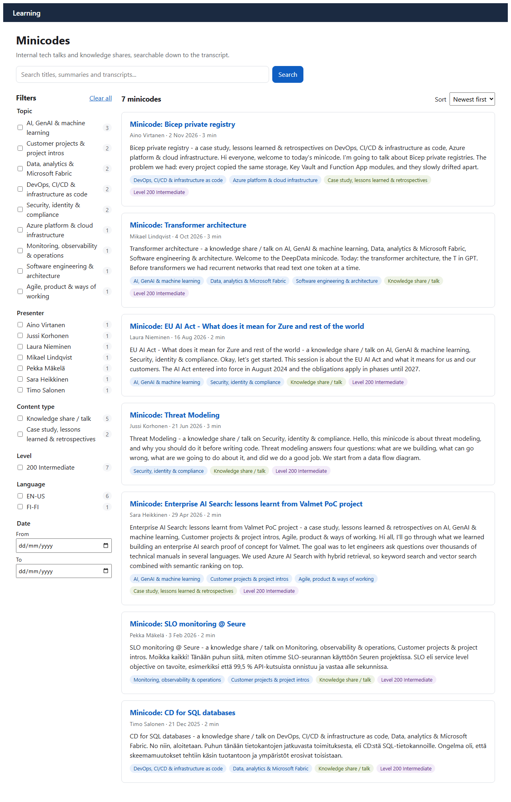
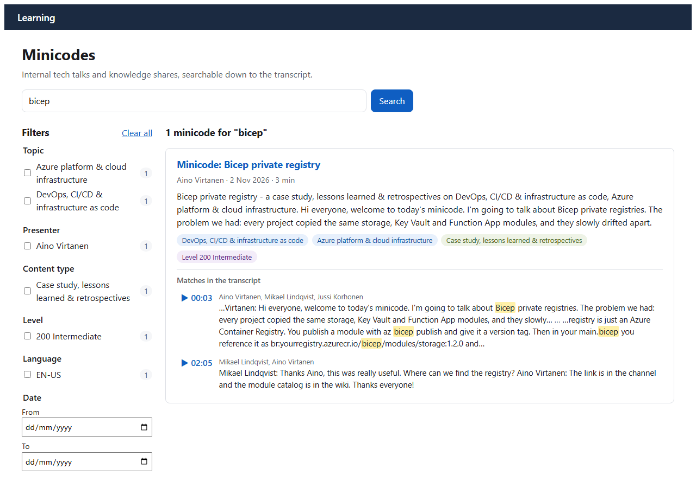
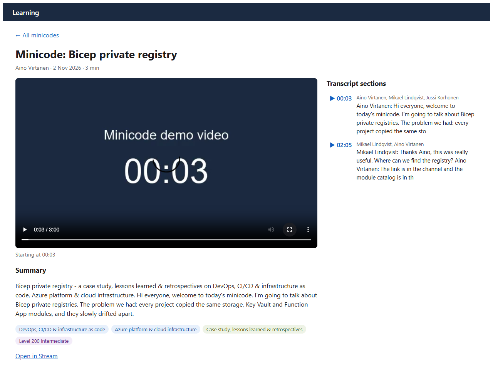

# Week 4 - Learning section (frontend)

A Vite + React 19 + TypeScript app in [`frontend/`](../frontend). It does two jobs:

1. It is a **standalone app** for the demo, or for hosting it on its own.
2. It is an **embeddable library** (`@minicode/learning-section`) that the portal team mounts inside the portal.

Both builds come from the same source.

| Feature | Where |
|---|---|
| Listing with paging and sort (newest, oldest, title, level) | `src/pages/ListingPage.tsx` |
| Full-text and transcript search, with highlighted chunk hits and timestamps | `ListingPage`, `components/MinicodeCard.tsx`, `components/Highlight.tsx` |
| Filters (topic, presenter, content type, level, language, date range), with facet counts | `components/FilterPanel.tsx` |
| Filter, search and page state kept in the URL query string (shareable, back/forward work) | `src/listingState.ts` |
| Detail page: video, summary, tags, transcript sections and "Open in Stream" | `src/pages/DetailPage.tsx` |
| Jump to a timestamp: a search hit opens `/minicodes/{id}?t=125`, and chapter buttons seek in place | `DetailPage`, `src/player/*` |
| Entra ID sign-in (MSAL React) and `Learning.Read` API tokens; dev mode with no Entra | `src/auth/*`, `src/main.tsx` |
| Typed API client for the week 3 endpoints | `src/api/client.ts`, `src/api/types.ts` |

## Screenshots (local demo, mock data)

Captured with `npm run screenshots` (Playwright) from the full-stack local demo below.

| Listing | Search results | Detail (opened from a search hit at 00:03) |
|---|---|---|
|  |  |  |

## Local full-stack demo

The backend uses mock data and `AUTH_MODE=dev`, so it needs no Azure or Entra. The frontend uses `VITE_AUTH_MODE=dev`, which is the default.

```powershell
# 1. Backend: ingest, enrich and index the mock data, then serve the API on :7071
python -m venv .venv; .venv\Scripts\pip install -r backend\requirements-dev.txt
cd backend
..\.venv\Scripts\python -m minicode.ingestion backfill --wait
..\.venv\Scripts\python -m minicode.enrichment run
$env:AUTH_MODE='dev'; ..\.venv\Scripts\python -m minicode.api serve

# 2. Frontend (in a second terminal). Vite proxies /api to http://localhost:7071.
cd frontend
npm ci
$env:VITE_PLAYER='html5'; $env:VITE_DEMO_VIDEO_URL='/demo/minicode-demo.mp4'
npm run dev            # http://localhost:5173
```

- Mock recordings point to SharePoint URLs that don't exist, so the demo plays `public/demo/minicode-demo.mp4` for every minicode in the HTML5 player.
  - It is a 3-minute clip with a burned-in timer, so you can check that jump-to-timestamp lands on the right second.
- Try searching for `bicep`. Click **▶ 02:05** on a hit and the detail page opens with the video at 2:05.

### Frontend commands

| Command | What it does |
|---|---|
| `npm run dev` | Dev server with HMR. `/api` is proxied to `MINICODE_API_PROXY` (default `http://localhost:7071`). |
| `npm run lint` | ESLint, including `jsx-a11y`, react-hooks and typescript-eslint. Zero warnings allowed. |
| `npm run typecheck` | `tsc -b` |
| `npm test` | Vitest, React Testing Library and MSW (API mocked at the network level). |
| `npm run build` | Builds the standalone app to `dist/app` and the library to `dist/lib` (ES module, CSS and `.d.ts`). |
| `npm run screenshots` | Playwright screenshots of the running app, saved to `docs/screenshots/`. Needs `npx playwright install chromium` once. |

CI (`.github/workflows/ci.yml`, job `frontend`) runs lint, typecheck, test and build on Node 24, and uploads both builds as an artifact.

### Standalone app settings (Vite env, `frontend/.env.local`)

| Variable | Default | Meaning |
|---|---|---|
| `VITE_AUTH_MODE` | `dev` | `dev` sends no tokens (backend `AUTH_MODE=dev`). `msal` makes users sign in with Entra ID. |
| `VITE_ENTRA_CLIENT_ID` | - | SPA app registration client ID (needed when `msal`). |
| `VITE_ENTRA_TENANT_ID` | - | Tenant ID (needed when `msal`). |
| `VITE_API_SCOPE` / `VITE_API_CLIENT_ID` | - | Either the full scope `api://<api-client-id>/Learning.Read`, or just the API client ID (the scope is then derived from it). |
| `VITE_API_BASE_URL` | `/api` | Search API base URL, e.g. `https://func-minicode-dev-xxxx.azurewebsites.net/api`. |
| `VITE_PLAYER` | `auto` | `auto`, `stream` or `html5` (see [Video player](#video-player)). |
| `VITE_DEMO_VIDEO_URL` | - | HTML5 video used for every item (local demo only). |

## Portal integration contract

We don't have access to the portal codebase, so the contract is a React component with a small set of props. The portal team picks one of the options below.

### Option A: mount as a library (recommended)

Install the package. Before the private repo exists, use `npm pack` in `frontend/` and install the tarball. Later, publish to a private registry such as GitHub Packages or Azure Artifacts.

```tsx
import { LearningSection } from "@minicode/learning-section";
import "@minicode/learning-section/style.css";

// Inside the portal's router:
<Route
  path="/learning/*"
  element={
    <LearningSection
      basePath="/learning"
      apiBaseUrl="https://func-minicode-prod-xxxx.azurewebsites.net/api"
      msalInstance={portalMsalInstance}                 // already initialize()d, with an active account
      apiScopes={["api://<api-client-id>/Learning.Read"]}
    />
  }
/>
```

**Peer dependencies** (the portal supplies these; they are not bundled):

| Package | Version |
|---|---|
| `react`, `react-dom` | ^19 |
| `react-router` | ≥7 |
| `@azure/msal-browser`, `@azure/msal-react` | ^5 |

If the portal uses different major versions, tell us. Option B avoids the version coupling.

**Props**

| Prop | Type | Default | Notes |
|---|---|---|---|
| `basePath` | `string` | `/` | The path the section is mounted at. Inside a host router it must match the route prefix (the route itself must be `basePath/*`). |
| `apiBaseUrl` | `string` | `/api` | Search API base, including `/api`. |
| `msalInstance` | `IPublicClientApplication` | - | The portal's MSAL instance. The section wraps itself in `MsalProvider`, signs the user in if needed, and acquires tokens silently, with a redirect fallback. |
| `apiScopes` | `string[]` | `[]` | `api://<api-client-id>/Learning.Read` |
| `getAccessToken` | `() => Promise<string \| null>` | - | Alternative to `msalInstance` if the portal has its own token plumbing. It takes precedence over `msalInstance`. |
| `player` | `"auto" \| "stream" \| "html5" \| PlayerOptions` | `auto` | `PlayerOptions.component` lets the portal plug in its own media component (see below). |
| `demoVideoUrl` | `string` | - | Demo only. |
| `className` | `string` | - | Added to the root `div.mcl-root`. |

**Behaviour the portal can rely on**

- **Routing.**
  - Inside a React Router context, the section uses the host router (`useInRouterContext`).
  - Otherwise it creates its own `BrowserRouter` with `basename = basePath`.
  - Its routes are `basePath/`, `basePath/minicodes/:id?t=<seconds>` and a not-found page.
- **Styling.**
  - All CSS is scoped under `.mcl-` class names, with theme variables on `.mcl-root`: `--mcl-accent`, `--mcl-fg`, `--mcl-muted`, `--mcl-border`, `--mcl-bg`, `--mcl-surface`, `--mcl-mark`, `--mcl-font` and `--mcl-radius`.
  - The portal can override those variables to match its theme.
  - There is no global reset. The page heading is an `h1`.
- **Auth.**
  - Every API call sends `Authorization: Bearer <token>`.
  - A 401 or 403 from the API shows an error message in the section; it doesn't redirect the whole portal.
  - `getAccessToken` returning `null` means "send no token", which is dev mode only.
- **Other exports.**
  - `createApiClient` (the typed API client), `createMsalTokenProvider`, `learningReadScope(clientId)`.
  - The player components (`VideoPlayer`, `StreamEmbedPlayer`, `Html5Player`, `withStartTime`, `choosePlayer`).
  - All API types.

### Option B: host the standalone app

Build with `npm run build:app` and serve `dist/app` from any static host.

- Configure the host with an SPA fallback, so every path returns `index.html`.
- Set `base` in `vite.config.ts` (or build with `--base /learning/`) if the app is not served from the root.
- The portal links to the app or iframes it.
- MSAL needs its own SPA app registration redirect URI for that origin.

### Hosting decision

**The portal team hosts the frontend** (Option A inside the portal bundle, or Option B on their static hosting). No Static Web App was added to Bicep, because the hosting choice belongs to the portal meeting.

The infra change is CORS on the Function App:

- `corsAllowedOrigins` in `infra/main.bicep` and `infra/env/*.bicepparam`.
- Dev allows `http://localhost:5173`.
- Prod is a TODO until the portal origin is known.

### Entra ID setup the integration needs

1. **SPA app registration** (the portal's own, or a new one for Option B).
   - Platform: *Single-page application*.
   - Redirect URIs: the portal origin(s), plus `http://localhost:5173/` for dev.
2. **API permission.** Add the delegated scope `api://<api-client-id>/Learning.Read` from the backend API registration (week 1 checklist) and grant admin consent.
   - Admins also need the `Learning.Admin` app role for the admin API. There is no admin UI yet.
3. **Pre-authorize** the SPA client ID on the API registration (*Expose an API → Authorized client applications*), so that users get no consent prompt.

## Video player

The detail page uses `VideoPlayer`, which chooses an implementation behind a single interface:

```ts
interface PlayerProps { minicode: MinicodeDetail; seek: { seconds: number; nonce: number }; title: string }
```

| Mode | Implementation | Seek |
|---|---|---|
| `stream` (and `auto` when the API returns `embedUrl`) | `StreamEmbedPlayer`: an `<iframe>` of the SharePoint/Stream embed URL | It rewrites the start time in the URL (`withStartTime`) and reloads the iframe on each seek (`key = nonce`). |
| `html5` (and `auto` when only a `videoUrl` exists) | `Html5Player`: a native `<video controls>` | It sets `currentTime`, waiting for `loadedmetadata` if needed. |
| no embed and no video | A link out to Stream (`webUrl`) | - |

Seeking happens on detail page load from `?t=`, and from the chapter buttons, which also update `?t` so that the URL can be shared at that point.

How the backend builds `embedUrl` (`backend/minicode/search/service.py`, `stream_embed_url`):

```
{siteUrl}/_layouts/15/embed.aspx?UniqueId={listItemUniqueId}&embed={"ust":true,"hv":"CopyEmbedCode"}&referrer=StreamWebApp&referrerScenario=EmbedDialog.Create
```

`listItemUniqueId` comes from Graph `driveItem.sharepointIds`. The start time is added by the frontend as `"st": <seconds>` inside the `embed` JSON. Search hits also carry a `url` deep link (`webUrl?nav=...`) for opening the recording in Stream at a timestamp.

> ⚠️ **Unverified:** the embed URL format, its `st` start-time parameter and the `nav` deep-link format come from what Stream's *Embed code* dialog and share links produce. They have not been tested against our tenant.
>
> To verify, open a real channel recording in Stream, choose **Share → Embed code** with *Start at* set, and compare the result with the format above. If it differs, change `stream_embed_url` (backend) and `withStartTime` (`frontend/src/player/streamUrl.ts`). Both have unit tests to update.
>
> Also check whether the embed plays inside the portal. Third-party cookie or iframe sign-in rules can block it, and in that case `auto` should prefer the link out.

## Accessibility and responsiveness

- **Labelling.**
  - The page has landmarks and headings.
  - The search form has `role="search"` and a labelled input.
  - Each filter group is a `fieldset`/`legend`. Each checkbox is labelled, e.g. "Aino Virtanen, 1 minicode".
  - The video region and the chapter buttons ("Play from 02:05") have their own labels.
- **Feedback.**
  - The result count is announced through an `aria-live` region.
  - Loading and error states use `role="status"` and `role="alert"`.
  - Search highlights are rendered as `<mark>`, with no `innerHTML`.
- **Keyboard and focus.**
  - Everything works with the keyboard, with a visible `:focus-visible` outline.
  - On the detail page, focus moves to the heading.
  - Pagination is a labelled `nav`, and the current page has `aria-current`.
- **Layout.**
  - Below 800 px the filters stack above the results, and the detail page stacks the video above the sections.
- **Checks.** ESLint `jsx-a11y` (recommended) runs in CI, and the tests query by role and label.

## Tests

16 Vitest tests across the API client, components and pages, plus backend tests for `embedUrl`.

- The API client sends the bearer token, joins multi-value filters with commas, and returns `ApiError` on non-2xx responses.
- Search hit highlighting is safe and does not use `innerHTML`.
- Player choice and `withStartTime`.
- On the listing page:
  - Filters are written to the URL and read back from it.
  - Facet counts are shown.
  - Search shows the highlighted hits.
  - Clicking a hit navigates to `?t=`.
- On the detail page: the summary, tags and chapters render, the HTML5 seek happens, and Stream mode uses the iframe with `st`.
- `LearningSection` mounts under a host router at `basePath`, and sends tokens from `getAccessToken`.

## Open questions

1. **Stream embed and `nav` formats are unverified** (see above). We also need to confirm that the embed works inside the portal.
2. **Integration option and versions.**
   - Library or hosted app?
   - Does the portal use React 19, React Router 7+ and MSAL 5?
   - How should the package be distributed (private npm feed or tarball)?
3. **Origins and app registration.**
   - The portal origin(s) are needed for CORS (`corsAllowedOrigins`, prod) and for the SPA redirect URIs.
   - Does the portal reuse its own SPA app registration, which then needs the `Learning.Read` permission?
4. **Admin UI.** The admin PATCH API exists. Should tag and title correction get a UI in the Learning section (week 5+), or is it enough to use it via API or tooling?
5. **Branding.** Should the portal provide theme tokens, or are the CSS variable overrides enough?
